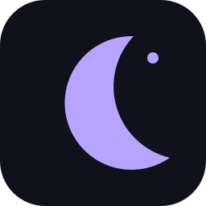

# LossWave

**Your music, your library, your next favorite track.**

A desktop music player for Windows, Linux, and macOS, with high-quality playback, synced lyrics, listening-history tools, and personalized discovery.

  
  
  

[**Downloads**](https://github.com/Erpt77/LossWave/releases) · [Builds & test results](https://github.com/Erpt77/LossWave/actions) · [Report a bug](https://github.com/Erpt77/LossWave/issues)

---

## Screenshots

  
    
  

## What is LossWave?

LossWave is a desktop music player focused on a comfortable listening experience and music discovery. It combines playback and library tools with synced lyrics, listening-history integrations, and personalized Daily Mixes.

## Features

- **Desktop playback** — listen to music in a dedicated desktop app.
- **Personalized Daily Mixes** — music shelves designed to help you revisit favorites and discover tracks based on available listening signals.
- **YouTube Music integration** — access supported YouTube Music features from the app.
- **Synced lyrics** — follow lyrics while a track plays when lyric data is available.
- **Last.fm scrobbling** — connect Last.fm to track listening activity and support music discovery.
- **Library tools** — manage your music and playback experience in one place.
- **Cross-platform builds** — packages are prepared for Windows, Linux, and macOS.

> Available features and recommendations can depend on your connected services, configuration, and the metadata available for a track.

## Downloads

Visit **[LossWave Releases](https://github.com/Erpt77/LossWave/releases)** for published installers and packages.

| Operating system | Package formats |
| --- | --- |
| Windows | .exe installer and portable .zip |
| Linux | .AppImage, .deb, and .rpm |
| macOS | .zip app bundle |

If no release has been published yet, open **[GitHub Actions](https://github.com/Erpt77/LossWave/actions)**, select the latest successful **Build and Release Desktop Apps** run, and look under **Artifacts**. Actions artifacts are build outputs and may expire; published release files are the preferred download location.

## Installation

1. Open the [Releases page](https://github.com/Erpt77/LossWave/releases).
2. Download the file that matches your operating system.
3. Install or launch it:
   - **Windows:** run the .exe installer, or extract the portable .zip.
   - **Linux:** open the .deb with your package installer, or make the .AppImage executable and run it. Use the .rpm on compatible distributions.
   - **macOS:** extract the .zip and move or launch the app as appropriate for your system.

## Build status and contributing

The [GitHub Actions page](https://github.com/Erpt77/LossWave/actions) shows build and test results for the desktop targets. Bug reports and feature suggestions are welcome through [GitHub Issues](https://github.com/Erpt77/LossWave/issues).

## Disclaimer

LossWave is an independent, open-source desktop project. It is not affiliated with, endorsed by, or sponsored by Google, YouTube, YouTube Music, Spotify, Apple, or Last.fm. Product names and trademarks belong to their respective owners.

LossWave does not host or distribute copyrighted music. Access to content and third-party services depends on those services and their terms. Use the app responsibly and follow applicable service terms and copyright laws.

## Credits

LossWave is a community fork based on [LastWave Desktop](https://github.com/Clash-Projects/LastWave-Desktop). Thanks to the original project contributors and the open-source libraries that make this project possible.
